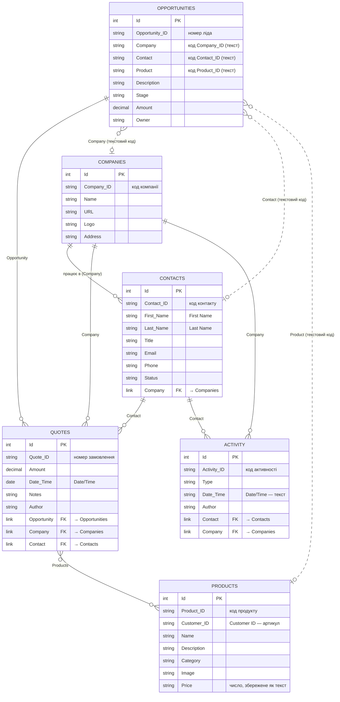

# Схема даних

Інтерфейс читає дані з бази NocoDB **BAB CRM v0625** (`pbje4jyruzt4csb`). Це навчальна CRM:
компанії та їхні контакти, ліди (Opportunities), замовлення (Quotes), каталог продуктів і
журнал активностей. UI працює лише на читання.

## ERD

Суцільні лінії — справжні поля-зв'язки NocoDB (Links). Пунктирні — текстові коди, які UI
зіставляє з записами сам (див. [Текстові посилання](#текстові-посилання)).

У діаграмі пробіли та `/` у назвах полів замінено на `_`, бо Mermaid їх не допускає.
Справжні назви — у лапках поруч.

## Таблиці

### Quotes — замовлення

| Поле | Тип | Опис |
|------|-----|------|
| `Quote_ID` | текст | Номер замовлення, основне значення запису |
| `Amount` | decimal (1 знак) | Сума |
| `Date/Time` | дата (`YYYY-MM-DD`) | Дата замовлення |
| `Notes` | текст | Примітки |
| `Author` | текст | Автор (замасковані адреси) |
| `Opportunity` | зв'язок → Opportunities | Лід, з якого виникло замовлення (одне значення) |
| `Company` | зв'язок → Companies | Компанія-клієнт (одне значення) |
| `Contact` | зв'язок → Contacts | Контактна особа (одне значення) |
| `Products` | зв'язок ↔ Products | Товари в замовленні, many-to-many |

### Opportunities — ліди

| Поле | Тип | Опис |
|------|-----|------|
| `Opportunity_ID` | текст | Номер ліда |
| `Company` | текст | Код компанії (`Company_ID`), не зв'язок |
| `Contact` | текст | Код контакту (`Contact_ID`), не зв'язок |
| `Product` | текст | Код продукту (`Product_ID`), не зв'язок |
| `Description` | текст | Опис |
| `Stage` | текст | Етап воронки |
| `Amount` | decimal (2 знаки) | Очікувана сума |
| `Owner` | текст | Відповідальний |
| `Quotes` | зв'язок ← Quotes | Замовлення цього ліда (зворотний бік) |

### Products — продукти

| Поле | Тип | Опис |
|------|-----|------|
| `Product_ID` | текст | Код продукту |
| `Customer ID` | текст | Артикул |
| `Name` | текст | Назва |
| `Description` | текст | Опис |
| `Category` | текст | Категорія |
| `Image` | текст | Посилання на зображення |
| `Price` | текст | Ціна; UI перетворює її на число |
| `Quotes` | зв'язок ↔ Quotes | Замовлення з цим товаром, many-to-many |

### Companies — компанії

| Поле | Тип | Опис |
|------|-----|------|
| `Company_ID` | текст | Код компанії |
| `Name` | текст | Назва |
| `URL` | текст | Сайт |
| `Logo` | текст | Посилання на логотип |
| `Address` | текст | Адреса |
| `Contacts` | зв'язок ← Contacts | Працівники компанії |
| `Quotes` | зв'язок ← Quotes | Замовлення компанії |
| `Activities` | зв'язок ← Activity | Активності з компанією |

### Contacts — контакти

| Поле | Тип | Опис |
|------|-----|------|
| `Contact_ID` | текст | Код контакту |
| `First Name`, `Last Name` | текст | Ім'я та прізвище |
| `Title` | текст | Посада |
| `Email`, `Phone` | текст | Контактні дані |
| `Status` | текст | Статус |
| `Company` | зв'язок → Companies | Компанія, де працює контакт (одне значення) |
| `Quotes` | зв'язок ← Quotes | Замовлення контакту |
| `Activities` | зв'язок ← Activity | Активності з контактом |

### Activity — активності

| Поле | Тип | Опис |
|------|-----|------|
| `Activity_ID` | текст | Код активності |
| `Type` | текст | Тип активності |
| `Date/Time` | текст | Дата й час, збережені як текст (на відміну від `Quotes.Date/Time`) |
| `Author` | текст | Автор (замасковані адреси) |
| `Contact` | зв'язок → Contacts | Контакт (одне значення) |
| `Company` | зв'язок → Companies | Компанія (одне значення) |

## Зв'язки

| Зв'язок | Кардинальність | Поле (прямий бік) | Поле (зворотний бік) |
|---------|----------------|-------------------|----------------------|
| Companies — Contacts | 1 : N | `Contacts.Company` | `Companies.Contacts` |
| Companies — Quotes | 1 : N | `Quotes.Company` | `Companies.Quotes` |
| Contacts — Quotes | 1 : N | `Quotes.Contact` | `Contacts.Quotes` |
| Opportunities — Quotes | 1 : N | `Quotes.Opportunity` | `Opportunities.Quotes` |
| Quotes — Products | M : N | `Quotes.Products` | `Products.Quotes` |
| Companies — Activity | 1 : N | `Activity.Company` | `Companies.Activities` |
| Contacts — Activity | 1 : N | `Activity.Contact` | `Contacts.Activities` |

Усі зв'язки необов'язкові: запис може не мати пов'язаного запису.

## Текстові посилання

`Opportunities.Company`, `.Contact` і `.Product` — звичайні текстові поля з кодами, а не
зв'язки NocoDB. UI шукає за ними запис у відповідній таблиці за полями `Company_ID`,
`Contact_ID` і `Product_ID`. Деякі коди збережені як округлені десятизначні числа з
плаваючою комою, і UI теж вважає їх збігом. Посилання, для якого запис не знайдено,
показується з пунктирним підкресленням.

## Системні поля

Кожна таблиця також має системні поля NocoDB: `Id` (первинний ключ), `CreatedAt`,
`UpdatedAt`, `nc_created_by`, `nc_updated_by` та службові. Для кожного зв'язку NocoDB
створює приховані службові таблиці `_nc_m2m_*`. На діаграмі та в таблицях вище їх не
показано (крім `Id`).
